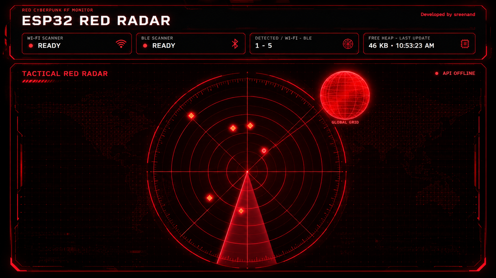

# ESP32 RADAR SCANNER

A passive Wi-Fi access-point and BLE-advertisement scanner for an ESP32-WROOM-32 / ESP32 DevKit V1. The ESP32 serves an offline dashboard with a canvas radar and a small procedural globe. The only project files needed are this guide and [`ESP32_RADAR_SCANNER.ino`](ESP32_RADAR_SCANNER.ino).

## Hardware

- ESP32 DevKit V1 using an ESP32-WROOM-32 module with 4 MB flash.
- USB data cable.
- No display, sensors, SD card, or extra wiring is required.

The firmware is receive-only for discovery: it does not connect to found Wi-Fi access points or BLE devices, request BLE scan responses, inject packets, or capture credentials.

## Libraries

Install the **esp32** board platform from **Espressif Systems** in Arduino IDE's Boards Manager. The sketch uses the platform's built-in `WiFi.h`, `WebServer.h`, and BLE scanner library (`BLEDevice.h`, `BLEScan.h`, and `BLEAdvertisedDevice.h`). No separate Library Manager packages, filesystem upload, JavaScript framework, or internet connection is needed by the device.

1. In Arduino IDE, open **File → Preferences**.
2. Add Espressif's stable Boards Manager URL if it is not already listed:
   `https://espressif.github.io/arduino-esp32/package_esp32_index.json`
3. Open **Tools → Board → Boards Manager**, search for **esp32**, and install **esp32 by Espressif Systems**. Use a current stable 3.x release.
4. Restart the IDE if it asks you to.

Espressif's [Arduino-ESP32 installation guide](https://docs.espressif.com/projects/arduino-esp32/en/latest/installing.html) describes the Boards Manager setup. The sketch's asynchronous Wi-Fi scan, passive BLE scan, and `WebServer.send_P()` calls use APIs in the [Arduino-ESP32 Wi-Fi API](https://docs.espressif.com/projects/arduino-esp32/en/latest/api/wifi.html) and the ESP32 core's bundled libraries.

## Configure and upload

1. Open `ESP32_RADAR_SCANNER.ino` in Arduino IDE.
2. Select **Tools → Board → esp32 → ESP32 Dev Module**. If your IDE has a specific DevKit V1 entry, that is also suitable.
3. Set **Tools → Flash Size → 4MB**.
4. Set **Tools → Partition Scheme → Huge APP (3MB No OTA/1MB SPIFFS)** when available. This project does not use a filesystem or OTA updates, so the larger app partition leaves more room for the firmware. A different partition is usable only if the IDE's compile output says the sketch fits its app limit. Espressif documents the [partition table choices](https://docs.espressif.com/projects/arduino-esp32/en/latest/tutorials/partition_table.html).
5. Leave **PSRAM** disabled for a standard WROOM-32 module.
6. Connect the ESP32, choose its port under **Tools → Port**, and click **Upload**. If upload pauses at “Connecting…”, hold the board's **BOOT** button briefly, then release it when writing starts.
7. Open **Tools → Serial Monitor**, choose **115200 baud**, and press the board's reset button. Startup, IP, scan outcomes, and free-heap readings appear there.

### Access Point mode (default)

The sketch is set to:

- SSID: `ESP32_RADAR`
- Password: `radar12345`
- Dashboard: `http://192.168.4.1`

Join that Wi-Fi network from a phone or computer, then open the address in a browser. Some phones warn that the hotspot has no internet; stay connected to it and continue to the address. The local dashboard endpoints have no separate login, so keep the AP password private.

### Station mode

At the top of the sketch, change `#define USE_ACCESS_POINT 1` to `#define USE_ACCESS_POINT 0`, then edit `STA_SSID` and `STA_PASSWORD`. Upload again. The assigned IP is printed to Serial Monitor after the ESP32 joins the network. Open `http://<printed-ip>/` from a device on the same local network. Credentials are not returned by the dashboard or printed to Serial Monitor.

## How scanning works

The firmware alternates a passive asynchronous Wi-Fi scan and a four-second passive BLE scan, then waits before the next cycle. It does not claim that both scan procedures run at once. The ESP32's access point remains active while the radio is shared; its dashboard may respond more slowly during channel scanning. The server loop continues handling HTTP while the scan APIs run asynchronously.

Up to 20 Wi-Fi access points and 20 BLE advertisers are retained. Duplicate BSSIDs/addresses update their existing records. Records expire after 70 seconds, and scan result buffers are cleared after processing. The web page polls compact status data and fetches the device list only when its revision changes.

Only Wi-Fi access points that advertise their presence and BLE devices that send advertisements can appear. This does not discover ordinary Wi-Fi clients. Some BLE advertisers use private or rotating addresses, so their displayed identifier and plotted position can change. RSSI placement is illustrative and is not a distance or location measurement.

## Memory estimate

No compilation was available in this workspace, so these are estimates, not measured build results. A typical ESP32 Arduino build with Wi-Fi and the bundled BLE stack may produce roughly **1.3–2.0 MB** of application image, depending on core release and build options. The selected 3 MB app partition provides headroom without consuming the whole 4 MB flash as an assumed sketch area. Check Arduino IDE's actual “Sketch uses … bytes” result before uploading; that value and the selected partition limit are authoritative.

At runtime, device records and JSON output buffers are statically bounded (about 12 KB combined, plus stack snapshots). Wi-Fi, BLE, and HTTP stack usage varies by core version and activity. The sketch prints current and minimum free heap at 10-second intervals so it can be observed on the actual board.

## Troubleshooting

- **`BLEDevice.h` not found:** install or select the Espressif `esp32` board platform; do not install a second, conflicting BLE implementation from Library Manager.
- **AP starts but scanning reports errors:** keep the ESP32 and browser device close to the Wi-Fi router/phone; reset the board and watch Serial Monitor. The scheduler continues to BLE after a Wi-Fi scan failure and retries on a later cycle.
- **BLE list is empty:** many devices advertise intermittently or only while in pairing/discovery mode. This scanner is passive and does not connect or request scan responses.
- **Browser cannot open the AP page:** confirm the computer is connected to `ESP32_RADAR`, turn off mobile-data auto-switching temporarily if it abandons Wi-Fi without internet, and enter `http://192.168.4.1` explicitly.
- **Station mode remains offline:** confirm the SSID and password were edited exactly, use a 2.4 GHz network, and read the printed connection state/IP in Serial Monitor.
- **Compile says the app is too large:** confirm **Flash Size = 4MB**, choose the **Huge APP (3MB No OTA/1MB SPIFFS)** partition, close duplicate board packages if the wrong core was selected, then compile again.
- **Upload cannot connect:** try a known data-capable USB cable, select the correct COM port, and hold **BOOT** while the IDE starts connecting.
- **Dashboard stalls briefly during a scan:** this is radio sharing on the single 2.4 GHz ESP32 radio. The scans are serialized to reduce conflicts; a scan can still briefly affect access-point responsiveness.

## Project Gallery

### Hardware Setup & Connections
.jpg)
.jpg)

### Red Cyberpunk Radar Interface
